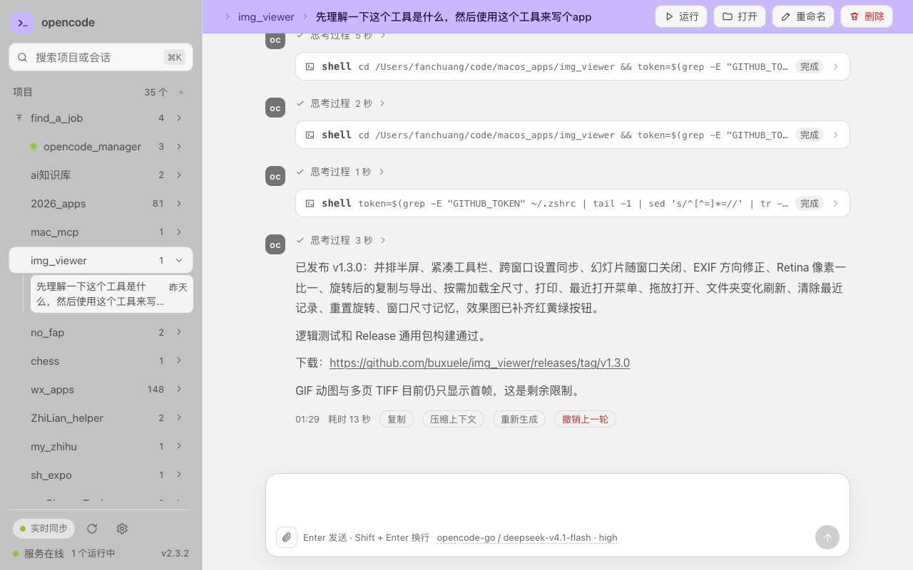

# opencode

本机 opencode 的项目与会话管理界面。左侧是项目与会话，右侧是会话内容，可以直接在页面里继续对话。


## 快速开始

1. 本机已安装 opencode、Python 3 与 Node.js。
2. 项目根目录执行启动脚本，依赖安装、前端构建、端口探测与打开页面都由脚本完成。
3. 启动脚本会先检查 opencode 后台服务，未运行就执行 opencode service start，不需要手动先开 opencode。

Windows 双击或在根目录执行 just_run.bat，macOS 在根目录执行 ./just_run.sh。

上面那条命令在前台运行，页面地址 http://127.0.0.1:7860/ ，终端标题固定为 opencode_manager:7860。重复启动会识别到本项目实例，直接打开页面并退出。macOS 若脚本没有执行权限，用 bash just_run.sh 启动。

## 功能

1. 会话：打开先显示最近 12 条，随后补足 30 条，可继续加载更早内容；支持 Markdown、思考过程折叠、工具卡片展开、一键复制与回到最新。
2. 继续对话：输入框直接发送，执行中可插话或中断；附件支持选择、拖拽与粘贴截图，历史附件按需取回原图。
3. 模型与 agent：会话头部一行内切换，只影响后续回合，列表里标注输入输出价格与免费标记。
4. 权限与表单：工具授权按始终允许自动处理；需要填写的表单在输入框上方直接提交。
5. 侧栏只列项目，按各自最新会话倒序，运行中显示绿点；点项目名在右侧打开项目页看会话。右键可新建会话、置顶、打开目录、在终端打开、复制启动命令与重命名。
6. 搜索与深链：⌘K 搜索会话与项目，地址栏可刷新与前进后退，草稿按会话保存。
7. 会话操作：头部重命名与删除；打开按钮在文件夹里定位项目，运行按钮在终端执行该项目的 just_run.bat 或 just_run.sh；最后一条助手消息行提供压缩上下文、重新生成与撤销上一轮。
8. 设置：会话完成提示音与三档背景色，选择存在浏览器本地。
9. 新建会话：先选目录再创建，弹窗默认当前项目；点浏览打开系统目录选择框，选中后回填路径，也可输入绝对路径或点最近项目，确认后直接打开新会话。
10. 长文本：一次粘贴超过 1000 字自动折叠成文本块，可查看、删除，发送时原样并入消息，避免大段文本卡住输入框。
11. 多机器：侧栏顶部可切换本机与局域网机器，同一套界面管理两台电脑上的 opencode；远端只保留跨机可用的操作。
12. 斜杠命令：输入 /more 这类已注册命令直接执行；不是已注册命令时按普通文本发送，路径不会被当成命令报错。



## 跨平台约定

1. 系统差异只放在 platform_ops.py。WindowsOps 与 MacOps 分别实现打开终端、定位文件夹、运行项目脚本与常用位置，server.py 只调用统一接口，不再出现系统判断。
2. 共同逻辑只有一份。接口代理、目录校验、页面与偏好结构都不区分系统，新增平台只需补一个适配类并注册到 current_ops。
3. 前端只做显示适配。快捷键符号与文件管理器称呼来自 GET /api/platform，页面行为不分叉。
4. 偏好只有一份数据。设置与置顶项目存在 ~/.config/opencode_manager/preferences.json，Windows 与 macOS 字段完全一致；浏览器 localStorage 只作为离线缓存，首次运行会自动把旧缓存迁移进该文件。
5. 打开项目目录也由适配层决定：macOS 在访达打开上级目录并选中项目，Windows 直接打开项目目录，两边都能立刻在项目里开终端。

## 目录结构

```
opencode_manager/
├── server.py              后端与静态托管
├── platform_ops.py        Windows 与 macOS 差异适配
├── preferences.py         本机偏好读写
├── ensure_opencode.py     检查并启动 opencode 后台服务
├── just_run.bat           Windows 一键启动
├── just_run.sh            macOS 一键启动
├── web/                   前端源码
├── tests/test_api.py      接口冒烟测试
├── tests/test_platform.py 平台与偏好单元测试
├── tests/test_ensure_opencode.py 自动启动单元测试
├── docs/                  接口与数据说明
├── 效果图/                 页面截图
└── 开发记录.md             迭代记录
```

## 配置

1. 端口写在 just_run.bat 与 just_run.sh 顶部的 PORT 变量，默认 7860。
2. 接口认证信息来自 opencode 的 service.json，项目自身不保存密钥。
3. 偏好文件默认是 ~/.config/opencode_manager/preferences.json，可用环境变量 OCM_PREFERENCES 指向其他路径。

## 测试

先启动服务，再执行对应命令。

Windows：.venv\Scripts\python.exe tests\test_api.py

macOS：.venv/bin/python tests/test_api.py

平台与偏好单元测试：.venv\Scripts\python.exe tests\test_platform.py，macOS 用 .venv/bin/python tests/test_platform.py。

自动启动单元测试：.venv\Scripts\python.exe tests\test_ensure_opencode.py，macOS 用 .venv/bin/python tests/test_ensure_opencode.py。

## 已知边界

1. opencode 未安装或启动失败时，启动脚本会直接报错退出，不进入页面。
2. 会话列表按游标分页拉取，前端每页 30 条。
3. 发送消息会真实调用模型，可能产生费用。
4. 只监听 127.0.0.1，不要直接暴露到公网。
5. 远程机器走明文 HTTP，只适合可信局域网；远端需要 opencode 2.x 且接口与本机一致。

接口清单与返回结构见 docs/接口与数据.md。
